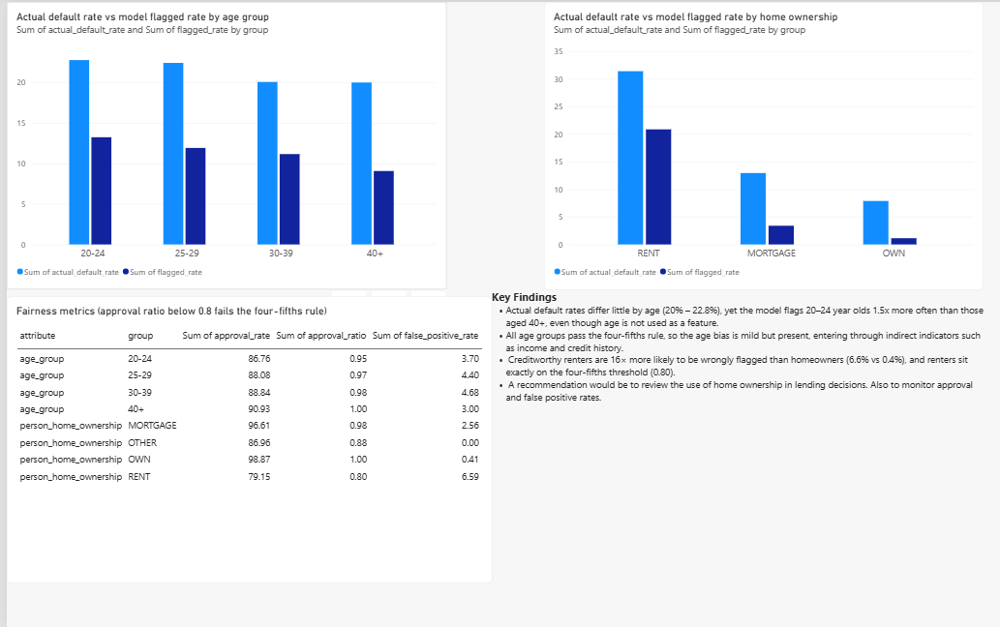

# Ethical Credit Risk Analysis: Fairness Audit 

## Dataset Content
- Dataset - Credit Risk dataset from Kaggle: https://www.kaggle.com/datasets/laotse/credit-risk-dataset 
The dataset contains 32,409 loan records (after cleaning in project 2), describing borrowers, their loans and whether they defaulted. 

## Business Requirements 
1. Identify whether default rates differ across age groups and home ownership types.
2. Assess whether a default prediction model trates these groups fairly, even when age is not used as a feature.
3. Communicate the findings and recommendations clearly to non-technical stakeholders through a dashboard. 

## Hypotheses
1. Default rates differ only slightly by age - This was validated as rates range from 20.2% to 23.3%, a gap of 3.1% 
2. Home ownership is strongly linked to default - Renters default at 31.6%, homeowners at 7.5%.
3. Removing age from a model does not remove age bias - This was validated as the model flags 13.2% of 20-24 year olds vs 9.1% of 40+ year olds, despite similar actual default rates.
4. Renters are disadvantaged by the model - This was validated as renters approval  ratio is 0.80 (on the threshold) and creditworthy renters are wrongly flagged 6.6% of the time vs 0.4% for homeowners

## Project Plan 
1. Data preparation ('01_data_preparation.ipynb'): load the cleaned data, check quality, create age groups.
2. Fairness audit ('02_fairness_audit.ipynb'): comapre default rates by group, train a logistic regression model without age and calculate fairness metrics.
3. Dashboard ('Dashboard/fairness_dashboard.pbix'):visulise the results for stakeholders. 
4. Documentation - This README, cover ethics and limitations

## Analysis Techniques
- Descriptive statistics and group comparisons
- Logistic regression (skikit-learn) trained without age, 'loan_grade' or 'loan_int_rate'
- Fairness metrics: 
    - Flagged rate: % predicted to default 
    - Approval ratio: each groups approval rate divided by the highest group's
    - False positive ratio: % of borrowers who did not default but were wrongly flagged. 
    - True positive rate: % of actual defaulters correctly flagged. 

## Key Findings
- Age: actual default rates are similar across age groups, but the model flags 20-24 year olds about 1.5 times as often as those 40+. All age groups pass the four-fifths rule (0.95-1.00), so bias is mild. 
- Older borrowers: Only 5.4% of the data is aged 40+. The model catches only 33.3% of defaulters in this group compared with 45.6% for 20-24s, meaning it is less reliable to an under-represented group.
- Home Ownership: This is the largest disparity. Creditworthy renters are around 16 times more likely to be wrongly flagged than homeowners and renters sit exactly on the four-fifths threshold. 
- Model performance: Accuracy is 83.7%, compared with 78% for a baseline that always predicts "no default", seen in project 2. 

## Ethical considerations
- Protected considerations: Age is a protected characterstic under the UK Equality Act 2010. Lending decisions that disadvantage an age group without a justified reason could amount to indirect discrimination. 
- Indirect bias: Even without age, features linked to age (income, credit history, renting) can reproduce age-related differences. Home ownership can also disadvantage people from a less wealthy background.
- Impact of errors: A false positive means a creditworthy person is refused credit. These erros happen far more commonly to renters, which can be seen as real-world harm. 
- Representation: Older borrowers are under-represented, so conclusions and model performance for this group are less certain. 

## Legal Considerations and Data Governance
- The dataset is publicly available under a CCO licence and contains no person data about real people. 

## Recommendations
1. Monitor approval rates and false positive rates by age group and home ownership regularly, not just overall accuracy.
2. Review whether home ownership should be used as a model feature, or test the model with and without it. 
3. Collect more data on older borrowers to improve reliability for that group. 

## Dashboard design 
Power BI Dashboard for non-technical stakeholders. 
- Actual vs flagged rate by age group (clustered column chart): shows the model flags young people more even though real outcomes are similar. 
- Actual vs flagged rate by home ownership(clustered column chart): shows the much larger gap for renters. 
- Fairness metrics table: Approval ratios against the four-fifths rule, and false positive rates. 
- Key finding text box. 
The 'OTHER' home ownership group is excluded from the chart because it is too small (23 test borrowers)

## Limitations
- The dataset has no gender or ethnicity columns, so fairness for those characteristics cannot be assessed. 
- Group sizes are uneven (only 375 borrowers aged 40+ in the test set), making some rates less stable. 
- Only one model (logistic regression) and one train/test split were tested. 

## Main Libraries Used
- Pandas - Loading and summarising data
- Matplotlib/ Seaborn - charts 
- scikit-learn - train/test split 
- Power BI - Dashboard 
 
 ## Credits 
 - Dataset: Kaggle Credit Risk Dataset 
 - Project template: Code Institute data anlytics template
 - Code:
    - Code institute LMS: Code creation for data cleaning and summarising and visualisations with matplotlib. 
    - Claude code (Anthropic): Project planning, code creation for logistic regression and preprocessing pipeline. Provided suggestions used such as includingthe four-fifths rule. 

